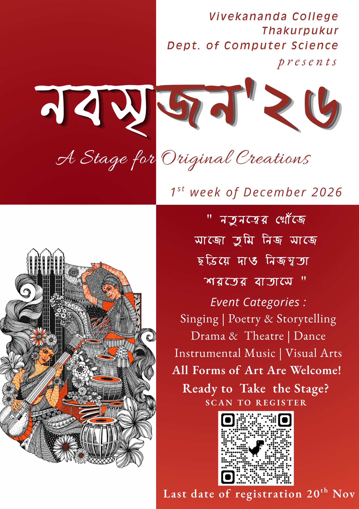
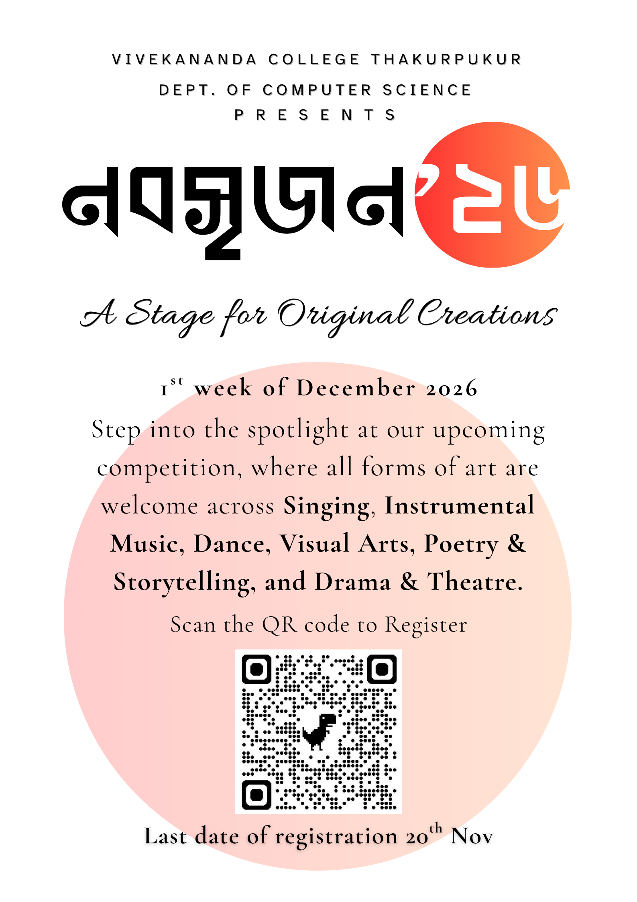
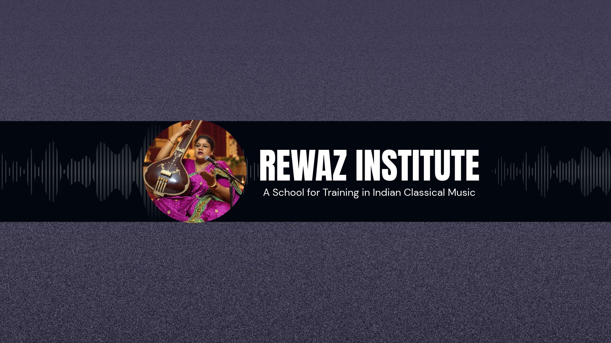
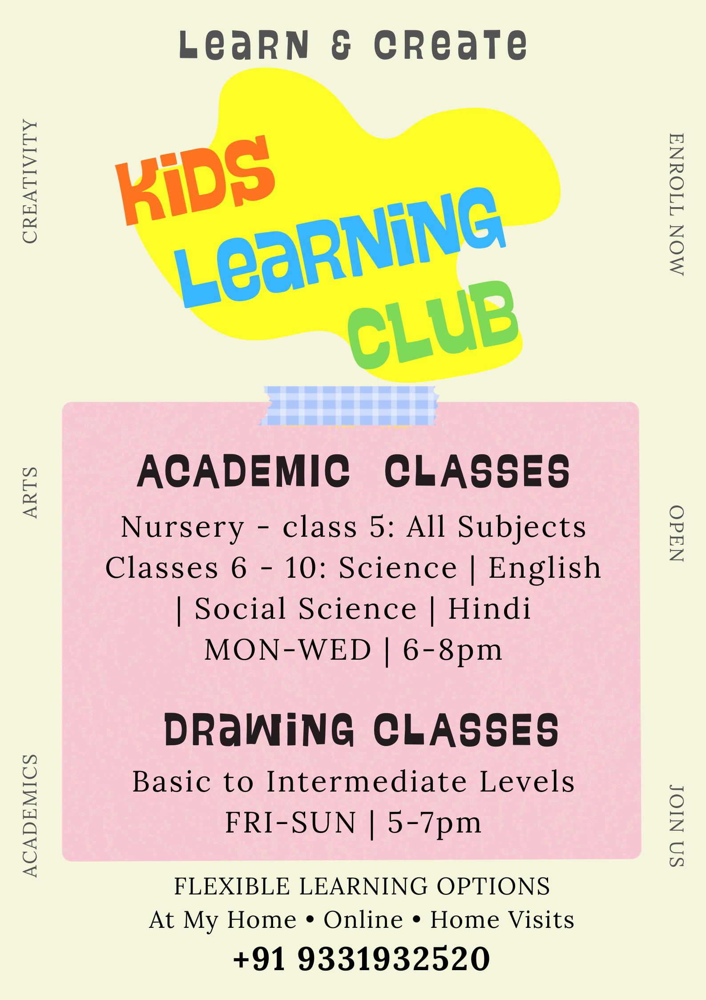
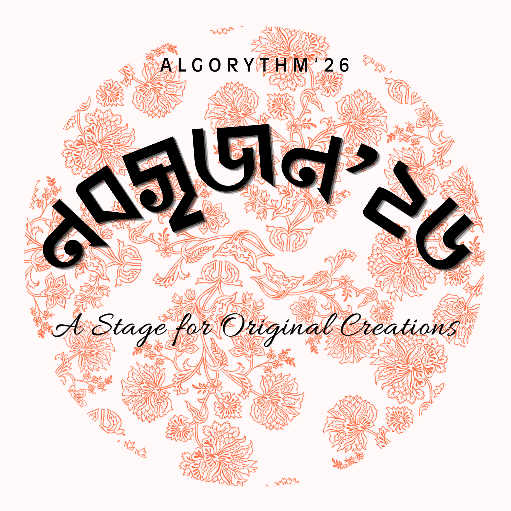
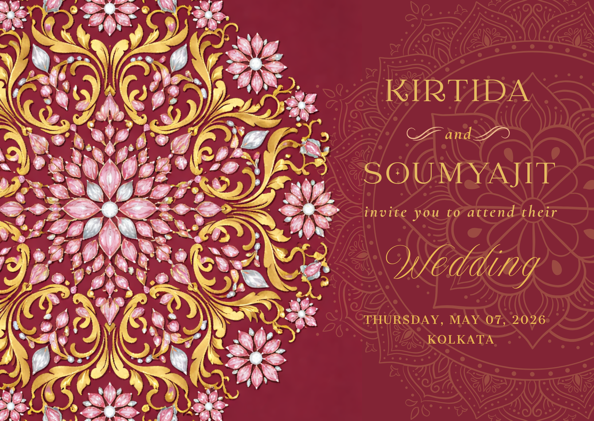

# Kesoree Dhar: Design Portfolio

B.Sc. Computer Science student from Kolkata. I design posters, logos and
promotional material in Canva, and I am building my skills in Excel,
Python and web development.

Contact: kesoreedhar@gmail.com

---

## 1. Nabasrijan'26 Poster (Version 2)

Poster for a cultural event organised by the Dept. of Computer Science,
Vivekananda College Thakurpukur. I worked on the layout, Bengali and
English typography, and the QR code for registration. Made in Canva.

## 2. Nabasrijan'26 Poster (Version 1)

An earlier draft of the same poster, with a floral theme. Comparing it
with Version 2 shows how I changed the layout and text size.

## 3. REWAZ Institute Banner

Promotional banner for an Indian classical music school, using a black
and gold theme to suit the traditional style. Made in Canva.

## 4. REWAZ Institute YouTube Banner

Channel banner sized for YouTube, with the name and tagline placed in
the centre safe area. Made in Canva.

## 5. Kids Learning Club Poster

Advertisement for school tuition and drawing classes, in a colourful,
child-friendly style with a clear schedule and contact details.
Made in Canva.

## 6. Algorythm'26 / Nabasrijan Logo

Circular event logo with Bengali lettering on a curved path over a
floral pattern. Made in Canva.

## 7. Wedding Invitation Card

Digital wedding invitation with a maroon and gold theme. I customised
the layout, text and colours in Canva. Shared with the family's
permission.

---

## Skills
**Using now:** Canva, Excel (formulas, charts, pivot tables), HTML, CSS,
Python (basics)

**Learning:** Word, PowerPoint, Power BI, Git/GitHub

## Coming soon
Excel projects, a PowerPoint presentation, a Word document sample and
Power BI dashboards.

## Note
Some design elements come from Canva's free library. The layout, text,
colours and customisation are my own work.
